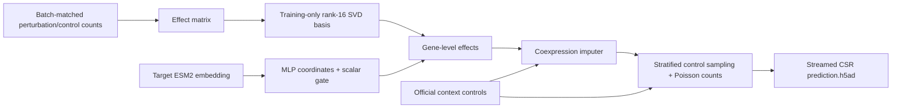

# Virtual Cell Low-Rank

ESM2-conditioned rank-16 perturbation effects, reconstructed from the final historical Virtual Cell Challenge experiment. This repository contains runnable code and a synthetic example; the deleted real datasets, embeddings and model weights are **not included**.

**技术路线：** 同 batch 的扰动/对照 → pseudobulk log1p 效应 → 训练集 SVD 响应基 → ESM2 靶基因编码预测 16 个模块系数 → 门控收缩 → control 共表达补全 → 匹配 control 的 Poisson 单细胞采样。



## Install and smoke example

Python 3.10+; CPU works for the synthetic example. Install an appropriate PyTorch CUDA build separately if needed.

```bash
python -m pip install -e '.[dev]'
vcell-lowrank demo --out runs/demo
pytest -q
```

The demo runs aggregation, target-held-out training, full-panel imputation, sparse cell expansion and local validation without downloading anything. Demo results are synthetic and are not a scientific benchmark.

## Inputs

Place your own files under `data/` (gitignored). Training sources must have raw integer counts in `X`, unique gene symbols, a target label and a batch/gem-group label. All training sources must be explicitly aligned to the same gene panel; the preparation tool rejects differing axes rather than treating unmeasured genes as zeros. `configs/sources.example.json` illustrates the source manifest. Paths in a manifest are relative to that manifest.

Embeddings can be a historical trusted PyTorch dictionary `{gene_symbol: vector}` or a pickle-free NPZ with `genes` (Unicode strings) and `vectors` (float32 matrix). Real historical ESM2 vectors had 5,120 dimensions. This project consumes embeddings; it does not download or train ESM2.

The prepared NPZ has `genes [G]`, `targets [N]`, `contexts [N]`, `delta [N,G]`, `n_cells [N]`. A target can appear in several contexts. `delta` means **natural-log log1p(mean raw counts) difference**, not log2 fold change or mean(log1p counts). Legacy object-array NPZs need explicit conversion to Unicode arrays before use.

For prediction, the control directory must contain:

```text
data/controls/
  gene_names.csv       # header; first column is the official gene order
  pert_counts.csv      # header; first column is the target panel
  context_A.h5ad       # control-only raw counts, exact official gene order
  context_B.h5ad
  context_C.h5ad
```

## Run on your data

```bash
vcell-lowrank prepare --manifest configs/sources.example.json --output data/effects.npz

# All records belonging to a held-out target stay out of training and SVD.
vcell-lowrank train --effects data/effects.npz --embeddings data/embeddings.npz \
  --rank 16 --steps 100 --seed 2 --device cpu --out runs/heldout

# Final fit: use a step count selected on held-out targets.
vcell-lowrank train --effects data/effects.npz --embeddings data/embeddings.npz \
  --rank 16 --steps 15 --seed 2 --train-all --out runs/full

vcell-lowrank predict --checkpoint runs/full/model.pt --embeddings data/embeddings.npz \
  --controls data/controls --out runs/abc_effects

vcell-lowrank expand --effects-dir runs/abc_effects --controls-dir data/controls \
  --cells-per-target 400 --output runs/prediction.h5ad

vcell-lowrank validate --h5ad runs/prediction.h5ad --cells-per-target 400
```

Use `--device cuda` for GPU training. CLI `--help` documents all options. Commands refuse to overwrite nonempty model/effect output directories and existing H5ADs. Validation checks local structure and raw counts; competition-specific limits and official packing/scoring must be checked with the official tools. This repository does not submit or upload predictions automatically.

## Model and objective

An uncentered SVD of training effect rows supplies basis `B [rank, genes]`. Target embeddings pass through `dim → 512 → rank` with GELU and dropout 0.1. A second `dim → 256 → 1` branch produces a sigmoid gate (final bias initialized to −2):

`predicted_effect = MLP(target_embedding) @ B * sigmoid(gate(target_embedding))`

The recovered loss combines Smooth L1 (beta 0.05), direction softplus on effects with absolute magnitude ≥0.05 (weight 0.25), an L1 null penalty below that threshold (weight 0.5), and mean gate penalty (weight 0.01). The magnitude threshold is a heuristic, not statistical DE significance. AdamW uses learning rate 2e-4, weight decay 1e-4 and gradient clipping 1.0.

**Historical “15 epochs” were actually 15 optimizer updates**, each on at most 32 randomly sampled effect rows. The CLI deliberately calls them `--steps`; it does not silently turn them into complete dataset epochs. Target and gene coverage exclusions are reported in the manifest. The recovered loss does not explicitly mask the perturbed target gene itself.

Unknown output genes inherit effect estimates from up to 16 positively correlated known genes in each context's sampled controls (correlation threshold 0.05). Unsupported genes receive zero effect. Counts always use each gene's own control baseline. The core predictor has no explicit context input; context adaptation occurs through controls and imputation.

Expansion applies `expm1(log1p(control_count) + effect)` only to existing nonzero control entries, clips rates and draws Poisson counts. Control zeros remain zero. The mean-level prediction is therefore not guaranteed to equal the expanded cell mean. Outputs stream to CSR HDF5 to avoid holding all 360,000 cells in memory.

## Historical evidence and limits

The final run was `esm2_lowrank_full_rank16_v1`, submitted as `esm2-lowrank-r16-controlpoisson-v1`. Historical records report 590 aggregate rows before ESM2 filtering, then 585 rows, 196 targets and 17,515 directly modeled genes. The official panel had 18,533 genes and 300 targets across A/B/C (400 cells/group).

Historical five-seed best NMAE proxy was approximately **0.909 ± 0.006**, against zero-effect 1.0. These are recovered records, **not results reproduced by this repository and not official scores**. The five-seed script evaluated with training-mode dropout enabled; this implementation uses evaluation mode. Original splits, weights and data were deleted, so exact numerical reproduction is unavailable. The known submission reached `scoring`; no final official score was recovered.

See [provenance and reconstruction changes](docs/PROVENANCE.md) and [method details](docs/METHODS.md).

## Upload to GitHub

Only code, documentation, config examples and tests should be versioned. `.gitignore` excludes datasets, weights, predictions and credentials. This project is ready for a new repository:

```bash
git init
git add .
git commit -m "Add reconstructed virtual cell low-rank pipeline"
git branch -M main
git remote add origin https://github.com/lanshui98/virtual-cell-lowrank.git
git push -u origin main
```

No remote repository has been created by this reconstruction. Choose a distribution license before publishing; no ownership or license of third-party data, embeddings or earlier dependencies is asserted here.
